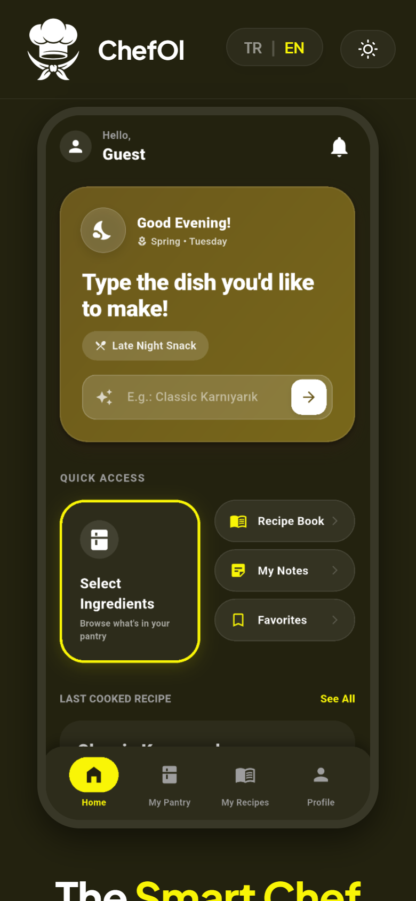
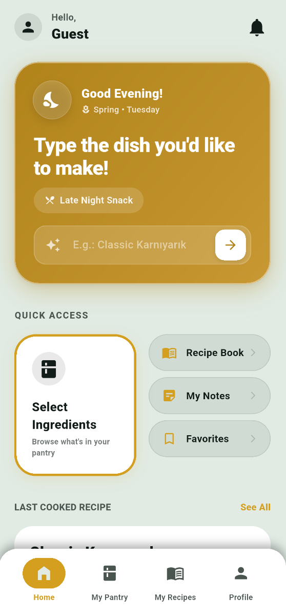

<p align="center">
  <a href="https://chefolapp.com">
    <picture>
      <source media="(prefers-color-scheme: light)" srcset="assets/logo2.png" />
      
    </picture>
  </a>
</p>

<h1 align="center">ChefOl</h1>

<p align="center">
  <strong>The Smart Chef in Your Kitchen</strong><br />
  The product website for the ChefOl recipe app.<br /><br />
  <strong><a href="https://chefolapp.com">https://chefolapp.com</a></strong>
</p>

<p align="center">
  <a href="https://chefolapp.com"></a>
  <a href="https://apps.apple.com/app/id6789093361"></a>
  <a href="https://play.google.com/store/apps/details?id=com.chefol"></a>
  <br />
  <a href="#tech"></a>
  <a href="#whats-on-the-site"></a>
  <a href="#tech"></a>
</p>

<p align="center">
  <a href="https://chefolapp.com">
    
  </a>
</p>

## About

ChefOl is an AI recipe app that turns available ingredients into recipes, with personal allergy profiles, dietary preferences and adjustable portions. It is available on the App Store and Google Play.

This repository contains the source of **[chefolapp.com](https://chefolapp.com)**, the product's brand and promotional website. It also publishes the **Terms of Service and Privacy Policy** used by the store listings, along with the support contact. The app's source is maintained in a separate private repository and is not included here.

## What's on the site

- **Product introduction and downloads:** a hero with an app preview, feature cards and a second download banner linking to both stores. The cards cover recipes, allergy and intolerance preferences, measurements, ingredients, chef customization, cooking mode, diets, a recipe editor and Baby Mode.
- **Turkish and English:** a language toggle for the page copy, legal texts and matching app mockups.
- **Dark and light themes:** matching colors, logos and app mockups. The initial theme follows the system preference; language and theme choices are remembered in the browser.
- **Legal and support:** expandable Terms of Service and Privacy Policy, plus an email contact in the footer.
- **Page details:** scroll reveals, a footer logo that returns to the top, social preview metadata, favicons, a web manifest and a bilingual custom 404 page with a link home.

## Screenshots

Captured from the live site in English, dark theme. The app screen is one of the mockups the site itself shows.

<table>
  <tr>
    <th width="50%">Website on a phone</th>
    <th width="50%">App home screen · light theme</th>
  </tr>
  <tr>
    <td align="center"><a href=".github/readme/mobile.png"></a></td>
    <td align="center"><a href="assets/mockup4.png"></a></td>
  </tr>
</table>

## Tech

Plain HTML, CSS and vanilla JavaScript, with **no framework, package installation or build step** for the website. Typography uses **Plus Jakarta Sans** from Google Fonts. The website code includes no analytics scripts and sets no cookies; it uses `localStorage` for language and theme preferences.

**GitHub Pages** serves the site through its Jekyll build from the root of `main`. The custom domain is recorded in `CNAME`, and HTTPS is enforced.

## Project layout

```text
.
├── index.html          # Landing page, store links and bilingual legal accordions
├── style.css           # Responsive layout, themes and animations
├── script.js           # Language, theme, accordions and scroll behavior
├── 404.html            # Custom not-found page
├── legal_texts.md      # Standalone Turkish and English legal texts
├── CNAME               # GitHub Pages custom domain
├── assets/             # Logos, app mockups, social preview and favicon/manifest files
└── .github/readme/     # Desktop and mobile website screenshots
```

## Run locally

Open `index.html` directly, or run a static server from the repository root:

```sh
python -m http.server 8000
```

Then visit [http://localhost:8000](http://localhost:8000). An internet connection is needed to load Google Fonts.

On the live site, GitHub Pages' Jekyll build also publishes `legal_texts.md` as a page at **[chefolapp.com/legal_texts](https://chefolapp.com/legal_texts)**; a plain local server shows it as a raw Markdown file. The same texts are in the accordions of `index.html`.

## Download the app

- **[App Store](https://apps.apple.com/app/id6789093361)**
- **[Google Play](https://play.google.com/store/apps/details?id=com.chefol)**

## Contact

Product support and legal inquiries: **[destek@chefolapp.com](mailto:destek@chefolapp.com)**

Developer: **Özcan Orhan Demirci** · [mail@ozcanorhandemirci.com](mailto:mail@ozcanorhandemirci.com)

## License

© 2026 Özcan Orhan Demirci. All rights reserved.

The source is public so the website can be viewed and checked. The code, ChefOl name and logo, app screenshots and legal texts are not licensed for reuse.
