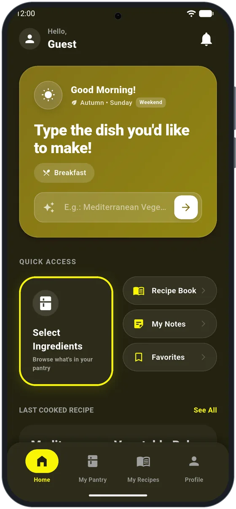
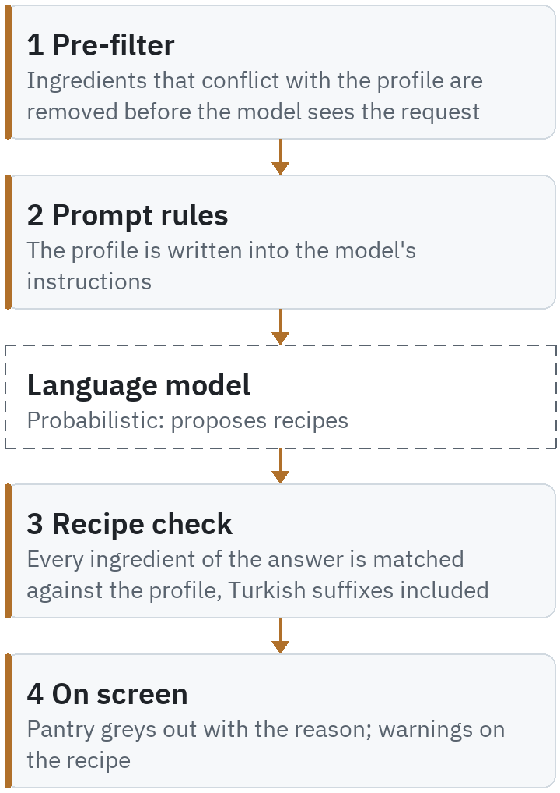
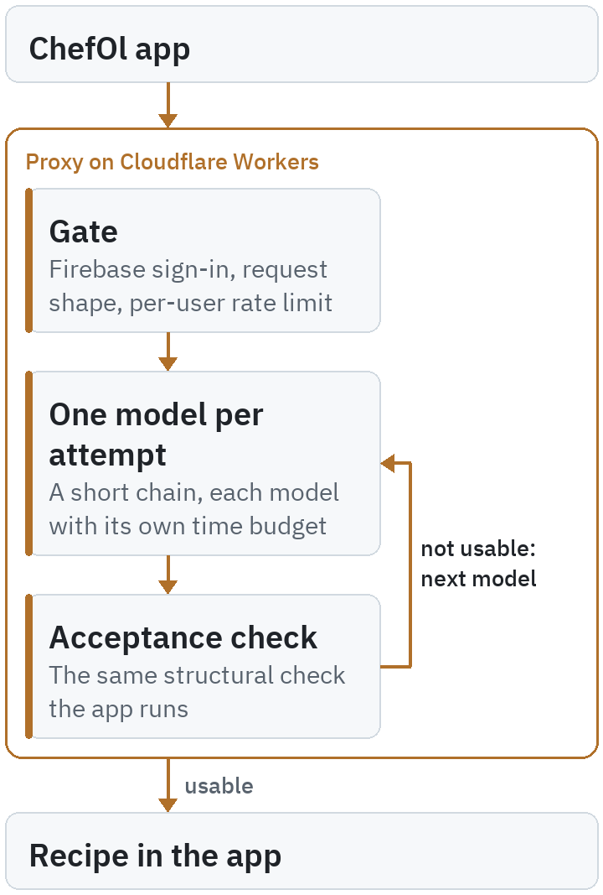
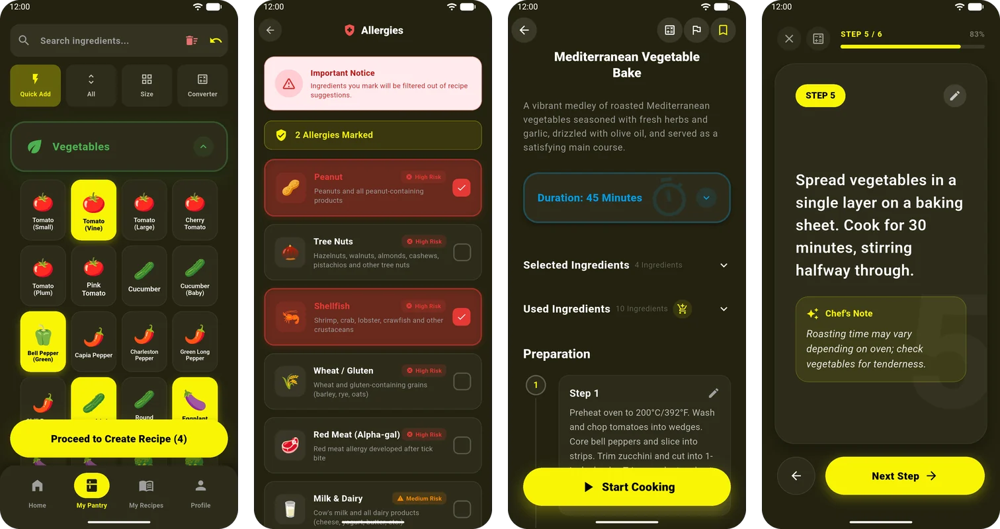
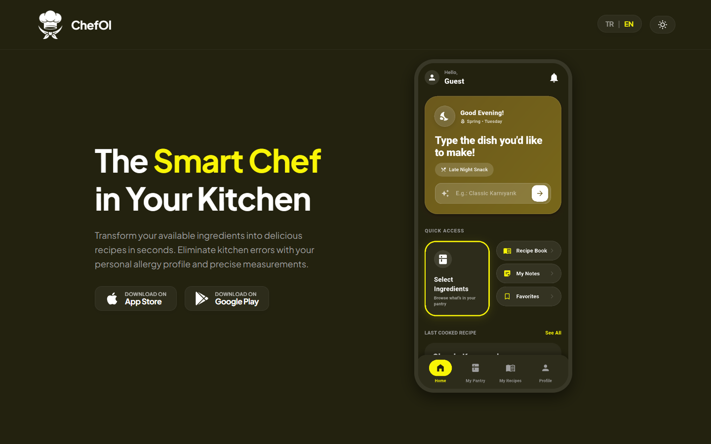
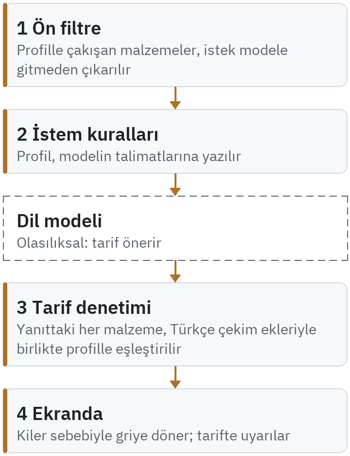
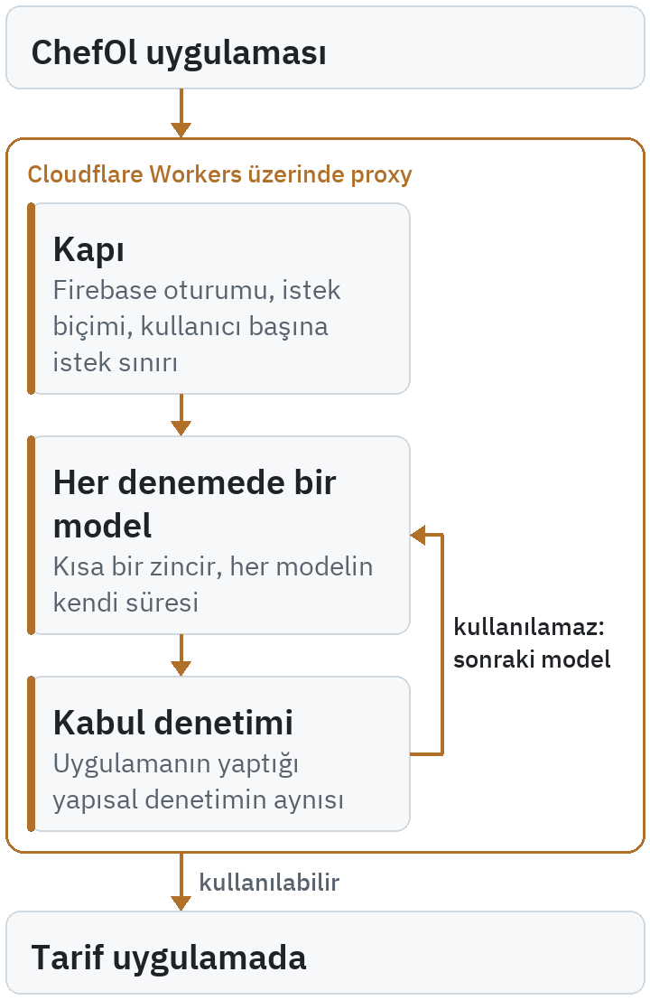
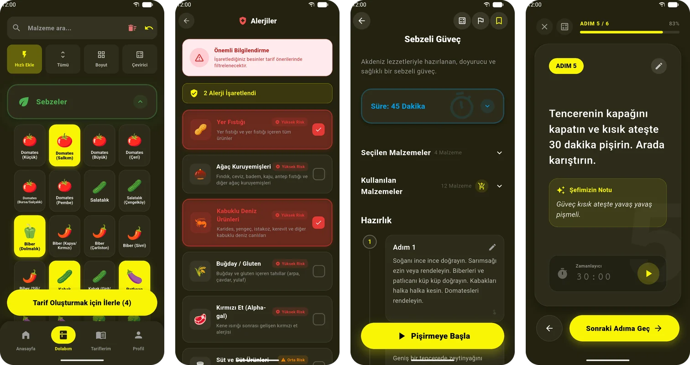

<!-- ChefOl: the app, its AI proxy (both private) and this repository, the website chefolapp.com. Pictures and how to rebuild them: .github/showcase/UPDATING.md. -->

# ChefOl

An allergy-sensitive recipe app: it turns the ingredients you have into recipes that respect your allergies, intolerances and diet, then walks you through cooking them. Live on the App Store and Google Play, in Turkish and English. I designed, built and shipped it on my own. The app and the AI proxy behind it are private; this repository is the app's website, and this page documents all three.

<a href="https://apps.apple.com/app/id6789093361"></a>&nbsp;<a href="https://play.google.com/store/apps/details?id=com.chefol"></a>

[chefolapp.com](https://chefolapp.com)

<p align="center"></p>

## <picture><source media="(prefers-color-scheme: dark)" srcset=".github/showcase/media/headings/n01-dark.png"></picture> What it does

- Pick what is in your kitchen from the pantry, or type the dish you would like to make. Set the course, the cuisine, the servings and the chef's style.
- Your health profile shapes every answer: 37 allergens, 28 intolerances and 23 lifestyles, with baby, child, pregnancy and breastfeeding modes. An ingredient that conflicts with it is greyed out in the pantry, with the reason.
- The recipe comes with its ingredients and steps; cooking mode then walks through it one step at a time.
- In the app you talk to "our chef". The AI provider is named where it matters: in the consent dialog, the privacy policy and the terms.

## <picture><source media="(prefers-color-scheme: dark)" srcset=".github/showcase/media/headings/n02-dark.png"></picture> The health engine

A language model is probabilistic: on any given request it can put a forbidden ingredient into a recipe. For a person with an allergy, a missed allergen (a false negative) is the failure that matters. So the model proposes and deterministic code decides. False alarms are reduced where that is possible; a miss is never traded for one. The prompt can get shorter over time; the code layers stay.

<p align="center"><picture><source media="(prefers-color-scheme: dark)" srcset=".github/showcase/media/diagrams/health-en-dark.png"></picture></p>

**Turkish is matched as Turkish.** The language builds words with suffixes: *yumurta* (egg) becomes *yumurtayla*, "with egg". Plain prefix matching misses some of these and catches verbs that only begin the same way. The matcher takes a stem plus a suffix from an explicit list, and that list grows only in the direction that cannot hide an allergen. When a missing suffix let *yumurtayla* through, it showed up as a failing test. The Turkish keyword *tart* was taken out because *tartın* means "weigh it".

**One sound rule is left out on purpose.** Turkish softens a final *k* to *ğ* before a vowel: *fıstık* becomes *fıstığı*. *Fıstık* alone usually means peanut, while *Antep fıstığı* is pistachio and *çam fıstığı* is pine nut. If the matcher applied the softening rule, every pistachio would look like a peanut, so the line between peanut and tree nuts rests on that one raw letter.

**"Free from" applies to one item at a time.** *Glutensiz ekmek* (gluten-free bread) drops the wheat match for that bread alone. *Laktozsuz süt* (lactose-free milk) still counts as milk for a milk allergy and for galactosemia, because lactose-free milk still contains galactose.

**The pantry never greys out without a reason.** An ingredient is disabled only when the engine can name why, and the grey, the reason, the icon and the pop-up all come from that one answer.

**Three outcomes, kept apart.** The user sees exactly one of them, and they do not mix:

- **Our Chef Protected You** (green): an allergy or intolerance is active and the model could not make a recipe that respects it.
- **Content Not Allowed** (red): the request breaks the content rules, even when an allergy is also set.
- **Our Chef Is Busy Right Now**: an error, a timeout or an empty answer. A timeout is never shown as protection; that would tell people they were kept safe when nothing was checked.

These rules sit under the app's suite of more than 7,000 automated tests. ChefOl is not a medical device and makes no medical claim; this section is about how the code lowers the chance of a miss.

## <picture><source media="(prefers-color-scheme: dark)" srcset=".github/showcase/media/headings/n03-dark.png"></picture> The AI proxy

The app never talks to a model provider directly. Between them is my own proxy on Cloudflare Workers, and several of my apps go through it.

<p align="center"><picture><source media="(prefers-color-scheme: dark)" srcset=".github/showcase/media/diagrams/proxy-en-dark.png"></picture></p>

**One repository, one Worker per app.** The apps share the code and the gate; each runs as its own Worker with its own configuration, secrets and rate limiter, so one app's traffic does not reach another's. Behaviour that only one app needs is added behind a switch, with a test that fails if the switch is taken away, so shared code never quietly changes under a neighbour.

**The gate.** Firebase sign-in is verified at the edge, the request's shape is checked, and a per-user rate limit is held in a Durable Object. The cheapest checks run first, so a request that fails early costs almost nothing. Users appear in the logs only as a short hash.

**Routing with an acceptance check.** The proxy walks a short chain of models itself, one model per attempt, each with its own time budget inside an overall deadline shorter than the app's own timeout. A model can answer with HTTP 200 and still return JSON the app cannot use. ChefOl does not stream, so the proxy reads the whole answer and runs the same structural check the app runs; if the answer fails, the next model is tried within the same request. The app keeps its own check as the last net.

**Simple on purpose.** No cache, no circuit breaker, no second provider, no streaming for ChefOl. Every one of a live app's recipe requests passes through here, and I wanted this part built once and solid, with nothing it does not need. A larger model was once tried at the head of the chain and taken out the same day: it was too slow for a short recipe in JSON.

## <picture><source media="(prefers-color-scheme: dark)" srcset=".github/showcase/media/headings/n04-dark.png"></picture> Privacy as a design choice

A person's health and diet preferences are there to filter recipe suggestions. No analytics event carries the name of an allergy or an intolerance, and a test fails if one does.

## <picture><source media="(prefers-color-scheme: dark)" srcset=".github/showcase/media/headings/n05-dark.png"></picture> Screens



<sub>The pantry · allergies · a generated recipe · cooking mode. English, dark theme.</sub>

## <picture><source media="(prefers-color-scheme: dark)" srcset=".github/showcase/media/headings/n06-dark.png"></picture> Built with

Flutter · Dart · Firebase (Auth, Firestore, Remote Config, Analytics) · Cloudflare Workers · Durable Objects · Cloudflare AI Gateway · OpenRouter

The source of the app and of the proxy is private; this repository holds the website and none of their code.

## <picture><source media="(prefers-color-scheme: dark)" srcset=".github/showcase/media/headings/n07-dark.png"></picture> The website

This repository is the source of **[chefolapp.com](https://chefolapp.com)**, ChefOl's brand site. It also publishes the Terms of Service and Privacy Policy that the store listings link to, and the support contact.

<a href="https://chefolapp.com"></a>

- **Introduction and downloads:** a hero with an app preview, feature cards and a second download banner for both stores. The cards cover recipes, allergy and intolerance preferences, measurements, ingredients, chef customization, cooking mode, diets, a recipe editor and Baby Mode.
- **Turkish and English:** a language toggle for the page copy, the legal texts and matching app mockups.
- **Dark and light themes:** matching colours, logos and mockups. The first theme follows the system; language and theme are remembered in the browser.
- **Legal and support:** expandable Terms of Service and Privacy Policy, an email contact in the footer, and the legal texts as their own page at [chefolapp.com/legal_texts](https://chefolapp.com/legal_texts).
- **Details:** scroll reveals, a footer logo that returns to the top, social preview metadata, favicons, a web manifest and a bilingual 404 page.

Plain HTML, CSS and vanilla JavaScript: no framework, no package installation, no build step. Plus Jakarta Sans from Google Fonts. No analytics scripts and no cookies; `localStorage` keeps the language and theme. GitHub Pages serves it through its Jekyll build from the root of `main`, on the custom domain in `CNAME`, with HTTPS enforced. Jekyll skips folders whose names start with a dot, so this page's pictures and the scripts that make them live under `.github/` and never reach the site.

<details>
<summary>Project layout and running it locally</summary>

<br>

- `index.html`: the landing page, store links and the bilingual legal accordions
- `style.css`: responsive layout, themes and animations
- `script.js`: language, theme, accordions and scroll behaviour
- `404.html`: the not-found page
- `legal_texts.md`: the Turkish and English legal texts as a page of their own
- `CNAME`: the GitHub Pages custom domain
- `assets/`: logos, app mockups, the social preview image, favicons and the web manifest
- `.github/readme/`: the website screenshot above
- `.github/showcase/`: the rest of this page's pictures, the scripts that build them and `UPDATING.md`

Open `index.html` directly, or serve the repository root and visit http://localhost:8000 (Google Fonts needs a connection):

```sh
python -m http.server 8000
```

A plain local server shows `legal_texts.md` as raw Markdown; on the live site Jekyll turns it into a page.

</details>

## <picture><source media="(prefers-color-scheme: dark)" srcset=".github/showcase/media/headings/n08-dark.png"></picture> Contact

[mail@ozcanorhandemirci.com](mailto:mail@ozcanorhandemirci.com) · [LinkedIn](https://www.linkedin.com/in/ozcan-orhan-demirci) · [My GitHub profile](https://github.com/OzcanOrhanDemirci)

<sub>Support for the app: [destek@chefolapp.com](mailto:destek@chefolapp.com)</sub>

<br>

<details>
<summary><b>Türkçe</b></summary>

<br>

### ChefOl

Alerjiye duyarlı bir yemek uygulaması: elinizdeki malzemeleri alerjinize, intoleransınıza ve beslenme tarzınıza uyan tariflere dönüştürür, sonra pişirirken adım adım yanınızda olur. App Store'da ve Google Play'de yayında, Türkçe ve İngilizce. Tasarımını, geliştirmesini ve yayınını tek başıma yaptım. Uygulama ve arkasındaki yapay zekâ proxy'si gizli; bu depo uygulamanın web sitesi ve bu sayfa üçünü de anlatıyor.

[App Store](https://apps.apple.com/app/id6789093361) · [Google Play](https://play.google.com/store/apps/details?id=com.chefol) · [chefolapp.com](https://chefolapp.com)

## <picture><source media="(prefers-color-scheme: dark)" srcset=".github/showcase/media/headings/n01-dark.png"></picture> Ne yapar

- Kilerden evdeki malzemeleri seçersiniz ya da canınızın çektiği yemeği yazarsınız. Öğünü, mutfağı, kişi sayısını ve şefin tarzını belirlersiniz.
- Sağlık profiliniz her yanıtı belirler: 37 alerjen, 28 intolerans ve 23 yaşam tarzı; bebek, çocuk, hamilelik ve emzirme modları. Profille çakışan malzeme kilerde griye döner ve nedeni yazar.
- Tarif malzemeleri ve adımlarıyla gelir; pişirme modu onu adım adım yürütür, adımda geçen süre için sayaç kurar.
- Uygulamada karşınızdaki "şefimiz"dir. Yapay zekâ sağlayıcısının adı gereken yerlerde açıkça yazar: onay penceresinde, gizlilik politikasında ve kullanım koşullarında.

## <picture><source media="(prefers-color-scheme: dark)" srcset=".github/showcase/media/headings/n02-dark.png"></picture> Sağlık motoru

Dil modeli olasılıksaldır: herhangi bir istekte tarife yasaklı bir malzeme koyabilir. Alerjisi olan biri için asıl önemli hata kaçırılan alerjendir (yanlış negatif). Bu yüzden model önerir, kararı belirlenimci kod verir. Yanlış alarm azaltılabildiği yerde azaltılır, ama bunun karşılığında asla bir kaçırma göze alınmaz. İstem zamanla kısalabilir; kod katmanları yerinde kalır.

<p align="center"><picture><source media="(prefers-color-scheme: dark)" srcset=".github/showcase/media/diagrams/health-tr-dark.png"></picture></p>

**Türkçe, Türkçe olarak eşleşir.** Türkçe sözcüğü eklerle kurar: *yumurta*, *yumurtayla* olur. Düz önek eşleştirmesi bu biçimlerin bir kısmını kaçırır, aynı harflerle başlayan fiilleri de yakalar. Eşleştirici kökü ve açıkça listelenmiş bir eki birlikte arar; bu liste yalnız alerjen gizleyemeyecek yönde büyür. Eksik bir ek *yumurtayla*'yı geçirdiğinde bunu düşen bir test gösterdi. Türkçe *tart* anahtarı da çıkarıldı, çünkü *tartın* bir fiil.

**Bir ses kuralı bilerek uygulanmaz.** Türkçede sondaki *k*, ünlüden önce *ğ*'ye yumuşar: *fıstık*, *fıstığı* olur. Tek başına *fıstık* çoğu zaman yer fıstığıdır; *Antep fıstığı* ve *çam fıstığı* ise ağaç yemişidir. Eşleştirici yumuşamayı uygulasaydı her Antep fıstığı yer fıstığı sanılırdı; yer fıstığı ile ağaç yemişleri arasındaki çizgi bu tek harfe dayanır.

**"-sız" yalnız kendi malzemesini etkiler.** *Glutensiz ekmek*, yalnız o ekmek için buğday eşleşmesini düşürür. *Laktozsuz süt* ise süt alerjisi ve galaktozemi için süt sayılmaya devam eder, çünkü laktozsuz sütte galaktoz vardır.

**Kilerde sebepsiz gri yok.** Bir malzeme ancak motor nedenini söyleyebiliyorsa devre dışı kalır; gri renk, sebep, ikon ve açılan pencere aynı yanıttan gelir.

**Üç sonuç, birbirine karışmadan.** Kullanıcı bunlardan yalnız birini görür:

- **Şefimiz Sizi Korudu** (yeşil): bir alerji ya da intolerans açık ve model ona uyan bir tarif üretemedi.
- **Bu İçerik Uygun Değil** (kırmızı): istek içerik kurallarına aykırı; yanında alerji seçili olsa bile.
- **Şefimiz Şu An Çok Yoğun**: hata, zaman aşımı ya da boş yanıt. Zaman aşımı asla koruma diye gösterilmez; hiçbir şey denetlenmemişken insana korunduğunu söylemek olurdu.

Bu kuralların altında uygulamanın 7.000'den fazla otomatik testi durur. ChefOl tıbbi bir cihaz değildir ve tıbbi bir iddiada bulunmaz; bu bölüm, kodun bir kaçırma ihtimalini nasıl düşürdüğünü anlatıyor.

## <picture><source media="(prefers-color-scheme: dark)" srcset=".github/showcase/media/headings/n03-dark.png"></picture> Yapay zekâ proxy'si

Uygulama hiçbir zaman model sağlayıcısıyla doğrudan konuşmaz. Arada Cloudflare Workers üzerinde çalışan kendi proxy'im var; uygulamalarımın birkaçı bu kapıdan geçer.

<p align="center"><picture><source media="(prefers-color-scheme: dark)" srcset=".github/showcase/media/diagrams/proxy-tr-dark.png"></picture></p>

**Tek depo, her uygulamaya bir Worker.** Uygulamalar kodu ve kapıyı paylaşır; her biri kendi yapılandırması, sırları ve istek sınırıyla ayrı bir Worker olarak çalışır, böylece bir uygulamanın trafiği ötekine ulaşmaz. Yalnız tek bir uygulamanın ihtiyacı olan davranış bir anahtarın arkasına eklenir ve anahtar kaldırılırsa kırmızıya dönen bir testle korunur; ortak kod komşusunun altında sessizce değişmez.

**Kapı.** Firebase oturumu kenar sunucuda doğrulanır, isteğin biçimi denetlenir, kullanıcı başına istek sınırı bir Durable Object'te tutulur. En ucuz denetimler önce çalışır; erken düşen bir istek neredeyse hiçbir şeye mal olmaz. Kullanıcılar günlüklerde yalnız kısa bir özetle görünür.

**Kabul denetimli yönlendirme.** Proxy kısa bir model zincirini kendisi yürütür: her denemede bir model, her birinin kendi süresi var ve hepsi uygulamanın zaman aşımından kısa bir genel süreye sığar. Bir model HTTP 200 dönüp yine de uygulamanın kullanamayacağı bir JSON verebilir. ChefOl akış (streaming) kullanmaz; proxy yanıtın tamamını okur ve uygulamanın yaptığı yapısal denetimin aynısını yapar; yanıt geçemezse aynı istek içinde sonraki model denenir. Uygulama kendi denetimini son güvence olarak tutar.

**Bilerek sade.** Önbellek yok, devre kesici yok, ikinci sağlayıcı yok, ChefOl için akış yok. Canlı bir uygulamanın her tarif isteği buradan geçiyor; bu parçanın bir kez ve sağlam kurulmasını, ihtiyacı olmayan hiçbir şey taşımamasını istedim. Bir ara daha büyük bir model zincirin başına kondu ve aynı gün çıkarıldı: kısa bir JSON tarif için fazla yavaştı.

## <picture><source media="(prefers-color-scheme: dark)" srcset=".github/showcase/media/headings/n04-dark.png"></picture> Tasarım tercihi olarak gizlilik

Kişinin sağlık ve beslenme tercihleri tarif önerilerini süzmek için vardır. Hiçbir analitik olayı bir alerjinin ya da intoleransın adını taşımaz; taşırsa bir test düşer.

## <picture><source media="(prefers-color-scheme: dark)" srcset=".github/showcase/media/headings/n05-dark.png"></picture> Ekranlar



<sub>Kiler · alerjiler · üretilmiş bir tarif · pişirme modunda sayaçlı adım. Uygulama Türkçe, koyu tema.</sub>

## <picture><source media="(prefers-color-scheme: dark)" srcset=".github/showcase/media/headings/n06-dark.png"></picture> Kullanılan teknolojiler

Flutter · Dart · Firebase (Auth, Firestore, Remote Config, Analytics) · Cloudflare Workers · Durable Objects · Cloudflare AI Gateway · OpenRouter

Uygulamanın ve proxy'nin kaynak kodu gizli; bu depo web sitesini içerir, onların kodlarından hiçbirini içermez.

## <picture><source media="(prefers-color-scheme: dark)" srcset=".github/showcase/media/headings/n07-dark.png"></picture> Web sitesi

Bu depo ChefOl'un marka sitesi **[chefolapp.com](https://chefolapp.com)**'un kaynağıdır. Mağaza sayfalarının bağlandığı Kullanım Koşulları ve Gizlilik Politikası ile destek iletişimi de buradan yayınlanır.

- **Tanıtım ve indirme:** uygulama önizlemeli bir giriş, özellik kartları ve iki mağazaya giden ikinci bir indirme alanı. Kartlar tarifleri, alerji ve intolerans tercihlerini, ölçüleri, malzemeleri, şef ayarlarını, pişirme modunu, beslenme tarzlarını, tarif düzenleyiciyi ve Bebek Modu'nu anlatır.
- **Türkçe ve İngilizce:** sayfa metni, yasal metinler ve uygulama görselleri için dil düğmesi.
- **Koyu ve açık tema:** uyumlu renkler, logolar ve görseller. İlk tema sistemi izler; dil ve tema tarayıcıda hatırlanır.
- **Yasal metinler ve destek:** açılır Kullanım Koşulları ve Gizlilik Politikası, altbilgide e-posta iletişimi ve yasal metinlerin kendi sayfası: [chefolapp.com/legal_texts](https://chefolapp.com/legal_texts).
- **Ayrıntılar:** kaydırınca beliren bölümler, başa dönen altbilgi logosu, sosyal önizleme bilgileri, favicon'lar, web manifesti ve iki dilli bir 404 sayfası.

Düz HTML, CSS ve JavaScript: çatı yok, paket kurulumu yok, derleme adımı yok. Analitik betiği ve çerez yok; dil ve tema `localStorage`'da tutulur. Siteyi GitHub Pages, `main` dalının kökünden Jekyll ile, `CNAME`'deki alan adında ve zorunlu HTTPS ile yayınlar. Jekyll adı noktayla başlayan klasörleri atladığı için bu sayfanın görselleri ve onları üreten betikler `.github/` altında durur ve siteye hiç çıkmaz.

## <picture><source media="(prefers-color-scheme: dark)" srcset=".github/showcase/media/headings/n08-dark.png"></picture> İletişim

[mail@ozcanorhandemirci.com](mailto:mail@ozcanorhandemirci.com) · [LinkedIn](https://www.linkedin.com/in/ozcan-orhan-demirci) · [GitHub profilim](https://github.com/OzcanOrhanDemirci)

<sub>Uygulama desteği: [destek@chefolapp.com](mailto:destek@chefolapp.com)</sub>

</details>

<br>

<sub>App Store and the Apple logo are trademarks of Apple Inc. Google Play and the Google Play logo are trademarks of Google LLC. ChefOl and its logo belong to Özcan Orhan Demirci. Other names belong to their owners.</sub><br>
<sub>© 2026 Özcan Orhan Demirci. All rights reserved. The website's source is public so it can be viewed and checked; the code, the ChefOl name and logo, the app screenshots and the legal texts are not licensed for reuse.</sub>
